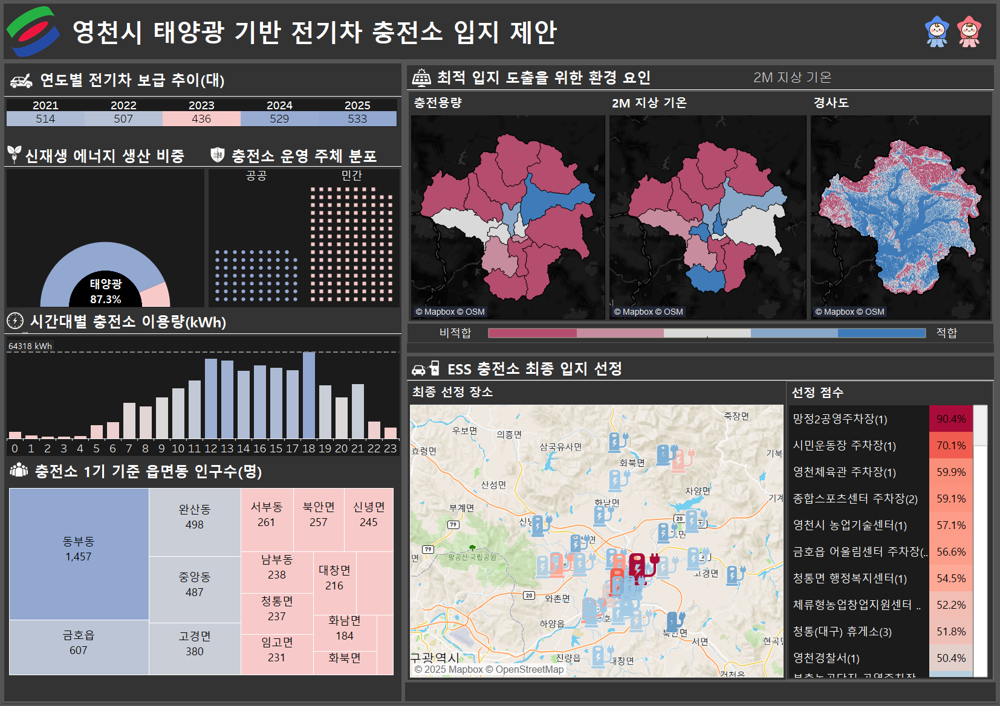

# 영천시 태양광 기반 전기차 충전소(ESS) 입지 선정

제4회 영천시 공공데이터 활용 경진대회 데이터 시각화 부문 | 팀 SolMate | 2025.05 - 2025.06

공공데이터 7종으로 영천시 공공 충전소 62곳의 ESS 설치 우선순위 산정.
7개 입지 지표를 Min-Max 정규화 후 가중합하고, 결과를 Tableau 대시보드로 시각화.

<br>



<br>

---

## 진행 흐름

1. 현황 분석: 보급 추세, 태양광 비중, 운영 주체, 시간대별 이용, 읍면동별 인프라
2. 충전기 데이터 정제: 출력(kW), 운영기관 구분, 위경도 기반 행정동 판별
3. 입지 지표 설계: 문헌 기반 7개 지표와 가중치
4. 정규화와 가중합으로 충전소별 점수 산정
5. 검증 (대회 이후 추가): 가중치 민감도, OLS 회귀 검토

- 레포의 수치는 공개 데이터로 다시 계산한 값으로, 발표 당시 수치와 다른 항목은 재구성 과정에서 생긴 차이 (괄호 안에 발표 당시 값 표기)

<br>

---

## 1. 배경

- 영천시 전기차 보급은 매년 430~530대 수준으로 지속 (2025년 533대로 최다)
- 신재생에너지 생산량의 대부분이 태양광 (84.4%, 발표 당시 87.3%)
- 충전 수요가 낮 시간대에 몰려 태양광 발전 시간과 겹침
- 태양광 + ESS 연계 충전소를 둘 공공 부지 우선순위 제안이 목표

<br>

---

## 2. 데이터

| 데이터 | 출처 | 용도 |
|---|---|---|
| 충전소 위치 및 운영정보 | 한국환경공단 | 후보지, 출력, 운영기관 |
| 행정동 경계 | 통계청 SGIS | 충전소 행정동 판별 |
| 읍면동별 인구 | 통계청 | 수요 밀도 |
| 기상 8개 항목 | 기상청 기상자료개방포털 (ASOS) | 일사량, 기온, 습도, 강수량 |
| 충전 이력 | 한국전력공사 | 시간대별 이용 |
| 신재생에너지 생산량 | 한국에너지공단 | 태양광 비중 |
| DEM | 국토정보플랫폼 | 경사도 (QGIS) |

파일별 기준일과 상세 출처는 [data/README.md](data/README.md)

<br>

---

## 3. 현황 분석 (`02_eda.py`)

| 항목 | 결과 |
|---|---|
| 전기차 보급 물량 | 2021년 514대 → 2025년 533대 (2023년 436대로 일시 감소) |
| 태양광 비중 | 신재생 생산량의 84.4% (발표 당시 87.3%) |
| 운영 주체 | 충전기 575대 중 공공 19.0%, 민간 81.0% (발표 당시 민간 80%) |
| 시간대별 이용 | 12~17시 충전 시작이 하루의 53.3% |
| 충전기 1대당 인구 | 신녕면 735명으로 최다, 서부동 80명으로 최소 |

- 민간 충전소는 사유지라 설치 협의가 어려워 공공 충전소(환경부, 한국전력, 한국전기차충전서비스)만 후보지로 선정
- 면 지역일수록 충전기 1대당 인구가 많아 인프라 불균형 확인

<br>

---

## 4. 충전기 데이터 정제 (`01_prepare_chargers.py`)

**제출 당시 데이터와 다른 이유**

- 제출 당시: 한국환경공단 전기자동차 충전소 정보 Open API로 대회 기간(2025년) 수집
- API는 조회 시점의 현재 데이터를 반환해, 실행 시점마다 충전소 목록이 달라지고 같은 결과를 재현하기 어려움
- 누구나 같은 결과를 얻을 수 있도록 같은 기관(한국환경공단)이 공공데이터포털에 파일로 공개한 2023-05-31 기준 데이터로 재구성
  - 충전소명, 위경도, 출력, 운영기관 등 점수 계산에 필요한 항목은 동일
  - 기상, 인구 데이터도 2023년 기준이라 시점 일치
- 파일 데이터와 API 데이터의 차이와 처리

| 항목 | API (제출 당시) | 파일 데이터 (현재) | 처리 |
|---|---|---|---|
| 충전소 ID | statId 제공 | 없음 | 충전소명 + 좌표로 구분 |
| 행정동 | 주소(addr)에서 추출 | 없음 (도로명 주소) | 위경도를 행정동 경계에 넣어 판별 |
| 출력 | 숫자(kW) | "급속(100kW단독)" 같은 문자열 | 숫자 추출, 표기 없으면 기본값 |
| 공공 충전소 수 | 69곳 | 62곳 | 시점 차이로 설치·철거 반영이 다름 |

<br>

**정제 과정**

- 619대 중 좌표 있는 579대, 시 경계 밖 좌표 오류 4대 제외 → 575대, 206곳
- 파일 데이터에 충전소 ID가 없어 이름과 좌표로 충전소 구분
- 출력: 표기값 사용, 표기 없는 급속은 50kW, 완속은 7kW
- 행정동: 도로명 주소에는 동 지역 행정동이 없어 위경도를 경계 다각형에 넣어 판별
  - 주소에 읍면이 적힌 충전기는 판별 결과와 전부 일치 (`tests/test_data.py`)

<br>

---

## 5. 입지 지표와 가중치

Khalife 외(2022)의 GIS-MCDA 충전소 입지 지표를 국내 데이터에 맞게 구성.
Asadi 외(2023)의 방식대로 Min-Max 정규화 후 가중합. 가중치는 선행연구의 AHP 가중치 참고.

| 지표 | 정의 | 가중치 | 방향 |
|---|---|---|---|
| 수요 밀도 | 충전소 총 출력 × 읍면동 인구 | 0.30 | 높을수록 |
| 피크 수요 | 충전소 총 출력(kW) | 0.25 | 높을수록 |
| 재생에너지 | 0.7 × GHI + 0.3 × DNI (정규화) | 0.15 | 높을수록 |
| 계통 연계 | 데이터 미확보, 상수 1 | 0.10 | - |
| 충전소 밀집도 | 반경 1km 내 다른 충전소 수 | 0.10 | 낮을수록 |
| 기후 및 환경 영향 | 기온 적합도(22.5℃ 기준), 상대습도, 총강수량의 정규화 가중평균 (가중치 0.05 : 0.05 : 0.025, 습도·강수는 낮을수록 유리) | 0.05 | 높을수록 |
| 공간 활용성 | 데이터 미확보, 상수 1 | 0.05 | - |

- 기상은 영천시 ASOS 관측 지점 1곳의 2023년 연평균을 모든 후보지에 동일하게 적용

<br>

---

## 6. 결과 (`03_site_scoring.py`)

| 순위 | 제출 당시 | 점수 | 재구성 | 점수 |
|---|---|---|---|---|
| 1 | 망정2공영주차장 | 0.904 | 망정2공영주차장 | 0.896 |
| 2 | 시민운동장 주차장 | 0.701 | 시민운동장 주차장 | 0.698 |
| 3 | 영천체육관 주차장 | 0.599 | 영천체육관 주차장 | 0.594 |
| 4 | 종합스포츠센터 주차장(2) | 0.591 | 종합스포츠센터 주차장(2) | 0.585 |
| 5 | 영천시 농업기술센터 | 0.571 | 영천시 농업기술센터 | 0.569 |

- 충전소 데이터 시점이 다른데도([4절](#4-충전기-데이터-정제-01_prepare_chargerspy)) 상위 5곳의 순서가 같음, 상위 10곳 중 7곳 일치
- 점수 차이(0.904 → 0.896)는 후보지 구성이 달라 Min-Max 정규화의 최솟값, 최댓값이 바뀐 영향
- 망정2공영주차장: 인구가 가장 많은 동부동 + 대용량 충전기 → 수요 밀도 1위
- 시민운동장 주차장: 총 출력 1,200kW로 피크 수요 1위

<br>

---

## 7. 결과 검증 (`04_sensitivity.py`, 대회 이후 추가)

**가중치 민감도**

- 기준 가중치 중심으로 가중치를 1,000번 무작위 변경해 상위 3위 진입 비율 확인
- 망정2공영주차장 100%, 시민운동장 99.9%, 영천체육관 75.7%, 영천시 농업기술센터 24.3%

<br>

**OLS 회귀 검토**

- 대회 당시: Asadi 외(2023)의 GIS-AHP 회귀 프레임워크를 따라, AHP 가중합 점수를 y로 입지 지표를 X로 OLS 회귀
- 논문은 기준값과 점수의 관계를 회귀식으로 모델링해 다른 지점의 점수를 추정하는 구조
- 이 프로젝트는 점수를 이미 계산한 같은 후보지에 회귀를 적용해 R² = 1.0, 정규화 지표 기준 회귀계수가 가중치(0.30, 0.25, 0.10)와 정확히 같음
- 같은 후보지에서는 가중치를 되찾을 뿐 새로운 정보가 없어 최종 점수는 가중합으로 산정
- 원본 단위 계수가 0.000213처럼 작게 나온 것도 단위 차이 때문으로 확인

<br>

---

## 8. 경사도 (QGIS)

대시보드 경사도 지도용. 코드 없이 QGIS로 처리.

1. 행정동 경계에서 영천시(37070) 추출, EPSG:4326 변환
2. DEM 타일 병합
3. 영천시 경계로 마스크 클리핑, 경계 밖 NoData(-9999)
4. 경사도(Slope, 도) 계산
5. 래스터 픽셀 → 포인트 변환, EPSG:4326 재투영
6. CSV 저장 (`data/raw/slope_points.csv`) 후 Tableau 연결

<br>

---

## 한계

**1. 충전소 데이터 재구성**
- 재현성을 위해 API 대신 같은 기관의 2023-05-31 파일 데이터로 재구성. 시점 차이로 후보지 69곳 → 62곳으로 일부 다름 ([4절](#4-충전기-데이터-정제-01_prepare_chargerspy))

**2. 기상 지표의 변별력 없음**
- 기상 관측 지점이 영천시 1곳이라 재생에너지, 기후 지표가 모든 후보지에 같은 점수
- 후보지 간 일사량 차이를 반영하려면 격자 단위 일사량 자료 필요

**3. 실질적으로 3개 지표가 순위 결정**
- 기상 2개 + 상수 2개(계통 연계, 공간 활용성)로 가중치 0.35가 모든 후보지에 같은 점수
- 순위는 수요 밀도, 피크 수요, 충전소 밀집도(가중치 합 0.65)로만 결정

**4. 수요 밀도 정의**
- 총 출력 × 인구라서 출력이 피크 수요와 중복 반영. 같은 읍면동 충전소는 인구가 같아 출력 차이만 남음

**5. 가중치 근거**
- 문헌을 참고해 설정한 가중치로, 쌍대비교 행렬과 일관성 비율(CR)은 산출하지 않음

**6. 후보지 범위**
- 기존 공공 충전소 중 ESS 추가 설치 우선순위. 충전소가 없는 신규 부지는 평가 대상 아님

**7. 경사도 미반영**
- 경사도는 대시보드 시각화에만 쓰고 점수에는 넣지 않음

<br>

---

## 레포 구조

```
src/
  data.py                  공통: 로드, 7개 지표, 정규화와 가중합
  01_prepare_chargers.py   충전기 정제, 행정동 판별
  02_eda.py                현황 분석
  03_site_scoring.py       입지 점수
  04_sensitivity.py        가중치 민감도, OLS 회귀 검토
data/
  raw/                     원천 데이터
  processed/               01번 결과
  submitted/               제출 당시 결과
results/                   스크립트별 결과 CSV, 그래프
tests/                     데이터 처리 검증
docs/                      대시보드 이미지
```

<br>

---

## 실행

```bash
pip install -r requirements.txt
cd src
python 01_prepare_chargers.py
python 02_eda.py
python 03_site_scoring.py
python 04_sensitivity.py
cd .. && pytest tests
```

<br>

---

## 참고 문헌

- Khalife, A., Fay, T.-A., & Göhlich, D. (2022). Optimizing public charging: An integrated approach based on GIS and multi-criteria decision analysis. *Sustainability*, 14(19), 12298.
- Asadi, M., Pourhossein, K., Noorollahi, Y., Marzband, M., & Iglesias, G. (2023). A new decision framework for hybrid solar and wind power plant site selection using linear regression modeling based on GIS-AHP. *Sustainability*, 15(10), 8359.
